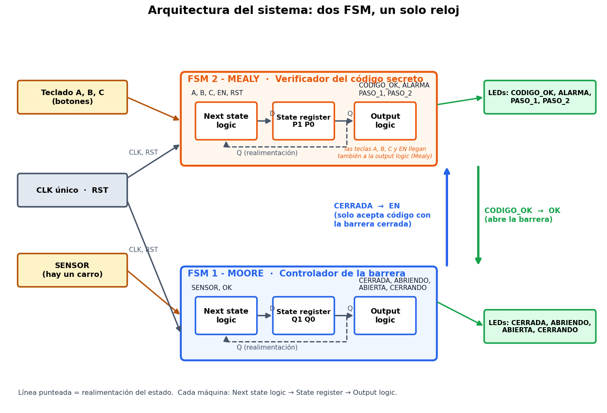
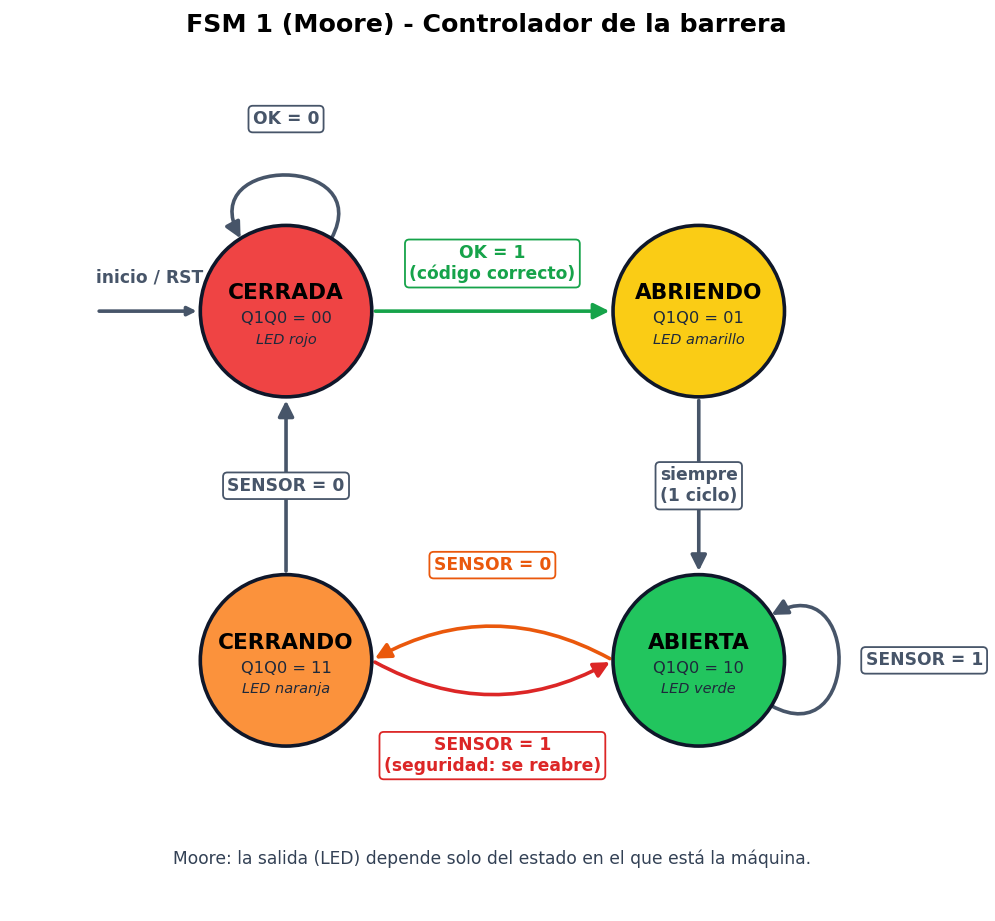
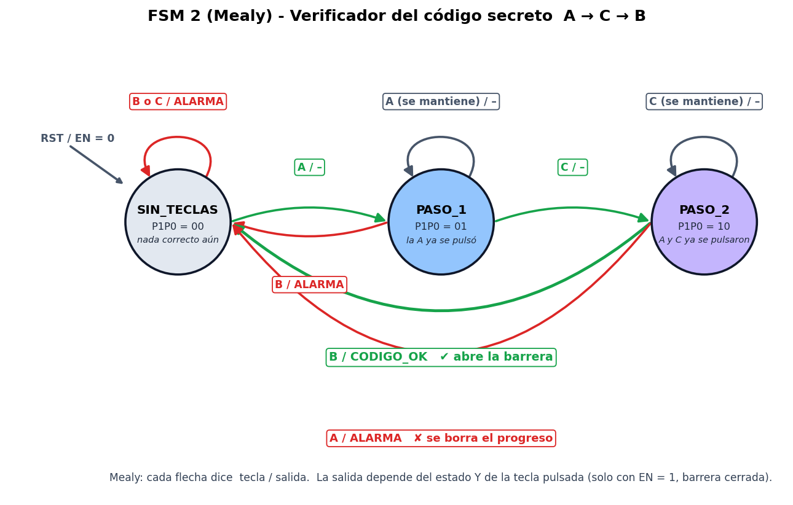

# FSM-Parking-system

**Barrera de estacionamiento con código secreto, controlada por dos máquinas de estados finitos (una Moore y una Mealy) que interactúan y comparten un mismo reloj.**


Proyecto de **Diseño Digital / Arquitectura de Computadoras** — capítulo 3: lógica secuencial y máquinas de estados finitos (FSM).

---

## Tabla de contenido
1. [Descripción](#1-descripción)
2. [Arquitectura del sistema](#2-arquitectura-del-sistema)
3. [FSM 1 — Moore: controlador de la barrera](#3-fsm-1--moore-controlador-de-la-barrera)
4. [FSM 2 — Mealy: verificador del código secreto](#4-fsm-2--mealy-verificador-del-código-secreto)
5. [Interacción entre las dos FSM](#5-interacción-entre-las-dos-fsm)
6. [Implementación en Logisim-evolution](#6-implementación-en-logisim-evolution)
7. [Cómo ejecutar la demostración](#7-cómo-ejecutar-la-demostración)
8. [Proceso y decisiones de diseño](#8-proceso-y-decisiones-de-diseño)

---

## 1. Descripción

Una barrera de estacionamiento se abre solo si el usuario teclea el **código secreto correcto**: pulsar `A`, luego `C`, luego `B`.
Una vez abierta, se mantiene así mientras haya un carro debajo (sensor de seguridad) y se cierra cuando la zona queda libre.

El problema se resuelve con **dos FSM separadas** (factorización) que se comunican entre sí:

| | **FSM 1 — Moore** | **FSM 2 — Mealy** |
|---|---|---|
| Función | Controlador de la barrera | Verificador del código secreto |
| Estados | 4: `CERRADA`, `ABRIENDO`, `ABIERTA`, `CERRANDO` | 3 usados: `SIN_TECLAS`, `PASO_1`, `PASO_2` |
| Codificación | Binaria, 2 flip-flops D (`Q1 Q0`) | Binaria, 2 flip-flops D (`P1 P0`) |
| Reset | **Asíncrono** (pin R del flip-flop) | **Síncrono** (dentro de la *next state logic*) |
| Salidas | Dependen **solo del estado** | Dependen del **estado y de las entradas** |
| Quién da la orden | Recibe `OK` de la FSM 2 | Recibe `EN` de la FSM 1 |

> **Moore vs Mealy en una frase:** en la Moore, la salida es *"en qué estado estoy"* (el LED de la barrera);
> en la Mealy, la salida es *"qué pasó con esta tecla en este paso"* (`CODIGO_OK` o `ALARMA`), por eso reacciona al instante.

---

## 2. Arquitectura del sistema



Cada máquina sigue la **topología de la presentación**: registro de estado + *next state logic* + *output logic*, con realimentación del estado.

```
entradas ──► [ Next state logic ] ──D──► [ State register (FF D + CLK + reset) ] ──Q──┬──► [ Output logic ] ──► salidas
                    ▲                                                                │   Moore: solo Q
                    └─────────────────────── Q (realimentación) ─────────────────────┘   Mealy: Q y entradas
```

### Entradas y salidas del sistema (circuito `top`)

| Señal | Tipo | Componente en Logisim | Descripción |
|---|---|---|---|
| `CLK` | entrada | Reloj | Reloj único de todo el sistema |
| `RST` | entrada | Interruptor | Reset común (asíncrono en la Moore, síncrono en la Mealy) |
| `A`, `B`, `C` | entrada | Botones | Teclado del código secreto (se pulsa una tecla a la vez) |
| `SENSOR` | entrada | Interruptor | 1 = hay un carro bajo la barrera |
| `CERRADA`, `ABRIENDO`, `ABIERTA`, `CERRANDO` | salida | LED | Estado de la barrera (FSM 1) |
| `PASO_1`, `PASO_2` | salida | LED | Progreso del código (FSM 2) |
| `CODIGO_OK` | salida | LED | Código correcto (FSM 2, Mealy) |
| `ALARMA` | salida | LED | Tecla equivocada (FSM 2, Mealy) |

---

## 3. FSM 1 — Moore: controlador de la barrera

Las salidas dependen **únicamente del estado actual**: hay un LED por estado.



### Codificación de estados

| Estado | Q1 | Q0 | LED |
|---|:---:|:---:|:---:|
| `CERRADA` | 0 | 0 | rojo |
| `ABRIENDO` | 0 | 1 | amarillo |
| `ABIERTA` | 1 | 0 | verde |
| `CERRANDO` | 1 | 1 | naranja |

### Tabla de transición de estados

| Estado actual | Q1 Q0 | SENSOR | OK | Estado siguiente | D1 D0 |
|---|:---:|:---:|:---:|---|:---:|
| `CERRADA` | 00 | X | 0 | `CERRADA` | 00 |
| `CERRADA` | 00 | X | 1 | `ABRIENDO` | 01 |
| `ABRIENDO` | 01 | X | X | `ABIERTA` | 10 |
| `ABIERTA` | 10 | 1 | X | `ABIERTA` | 10 |
| `ABIERTA` | 10 | 0 | X | `CERRANDO` | 11 |
| `CERRANDO` | 11 | 1 | X | `ABIERTA` | 10 |
| `CERRANDO` | 11 | 0 | X | `CERRADA` | 00 |

`X` = no importa. La tabla completa de 16 filas está en [`tablas/fsm1_moore_transiciones.csv`](tablas/fsm1_moore_transiciones.csv).

### Tabla de salidas (Moore)

| Estado | Q1 Q0 | `CERRADA` | `ABRIENDO` | `ABIERTA` | `CERRANDO` |
|---|:---:|:---:|:---:|:---:|:---:|
| `CERRADA` | 00 | **1** | 0 | 0 | 0 |
| `ABRIENDO` | 01 | 0 | **1** | 0 | 0 |
| `ABIERTA` | 10 | 0 | 0 | **1** | 0 |
| `CERRANDO` | 11 | 0 | 0 | 0 | **1** |

### De la tabla a las ecuaciones (un término AND por flecha del diagrama)

| Flecha del diagrama | Término AND | Se suma en |
|---|---|:---:|
| `CERRADA` → `ABRIENDO` (si `OK = 1`) | `Q1'·Q0'·OK` | `D0` |
| `ABRIENDO` → `ABIERTA` | `Q1'·Q0` | `D1` |
| `ABIERTA` → `ABIERTA` o `CERRANDO` (cualquier `SENSOR`) | `Q1·Q0'` | `D1` |
| `ABIERTA` → `CERRANDO` (si `SENSOR = 0`) | `Q1·Q0'·SENSOR'` | `D0` |
| `CERRANDO` → `ABIERTA` (si `SENSOR = 1`, seguridad) | `Q1·Q0·SENSOR` | `D1` |
| `CERRADA` → `CERRADA` y `CERRANDO` → `CERRADA` | *(ninguno: el siguiente estado es 00)* | – |

```
D1 = Q1'·Q0 + Q1·Q0' + Q1·Q0·SENSOR
D0 = Q1'·Q0'·OK + Q1·Q0'·SENSOR'

CERRADA = Q1'·Q0'     ABRIENDO = Q1'·Q0
ABIERTA = Q1·Q0'      CERRANDO = Q1·Q0
```

---

## 4. FSM 2 — Mealy: verificador del código secreto

Detector de secuencia **A → C → B**. Las salidas `CODIGO_OK` y `ALARMA` dependen **del estado y de la tecla pulsada**,
por eso cambian al instante, sin esperar el flanco del reloj. Solo se acepta código con la barrera cerrada (`EN = 1`).



Si `EN = 0` (la barrera no está cerrada) o `RST = 1`, desde cualquier estado se regresa a `SIN_TECLAS`.

### Codificación de estados

| Estado | P1 | P0 | LED | Significado |
|---|:---:|:---:|:---:|---|
| `SIN_TECLAS` | 0 | 0 | – | Ninguna tecla correcta todavía |
| `PASO_1` | 0 | 1 | azul | La `A` ya se pulsó |
| `PASO_2` | 1 | 0 | violeta | `A` y `C` ya se pulsaron |
| *(no usado)* | 1 | 1 | – | Se trata como `00`: la máquina nunca queda atrapada |

### Tabla de transición y salidas (con `EN = 1`, `RST = 0`)

| Estado actual | P1 P0 | Tecla | Estado siguiente | P1' P0' | Salida (Mealy) |
|---|:---:|:---:|---|:---:|:---:|
| `SIN_TECLAS` | 00 | ninguna | `SIN_TECLAS` | 00 | – |
| `SIN_TECLAS` | 00 | **A** | `PASO_1` | 01 | – |
| `SIN_TECLAS` | 00 | B | `SIN_TECLAS` | 00 | 🔴 `ALARMA` |
| `SIN_TECLAS` | 00 | C | `SIN_TECLAS` | 00 | 🔴 `ALARMA` |
| `PASO_1` | 01 | ninguna | `PASO_1` | 01 | – |
| `PASO_1` | 01 | A (se mantiene) | `PASO_1` | 01 | – |
| `PASO_1` | 01 | B | `SIN_TECLAS` | 00 | 🔴 `ALARMA` |
| `PASO_1` | 01 | **C** | `PASO_2` | 10 | – |
| `PASO_2` | 10 | ninguna | `PASO_2` | 10 | – |
| `PASO_2` | 10 | A | `SIN_TECLAS` | 00 | 🔴 `ALARMA` |
| `PASO_2` | 10 | **B** | `SIN_TECLAS` | 00 | 🟢 `CODIGO_OK` |
| `PASO_2` | 10 | C (se mantiene) | `PASO_2` | 10 | – |

La tabla completa (todas las combinaciones de `P1, P0, A, B, C, EN, RST`) está en
[`tablas/fsm2_mealy_transiciones_y_salidas.csv`](tablas/fsm2_mealy_transiciones_y_salidas.csv).

### De la tabla a las ecuaciones

**Next state logic** (todos los términos llevan `RST'·EN`, porque con reset o barrera no cerrada el siguiente estado es 00):

| Flecha del diagrama | Término AND | Se suma en |
|---|---|:---:|
| `SIN_TECLAS` → `PASO_1` (tecla `A`) | `RST'·EN·P1'·P0'·A` | `D0` |
| `PASO_1` → `PASO_1` (`A` o ninguna tecla) | `RST'·EN·P1'·P0·B'·C'` | `D0` |
| `PASO_1` → `PASO_2` (tecla `C`) | `RST'·EN·P1'·P0·C` | `D1` |
| `PASO_2` → `PASO_2` (`C` o ninguna tecla) | `RST'·EN·P1·P0'·A'·B'` | `D1` |
| Cualquier tecla equivocada o `B` correcta | *(ninguno: el siguiente estado es 00)* | – |

**Output logic** (Mealy: usa estado **y** teclas):

| Salida | Cuándo se activa | Término(s) |
|---|---|---|
| `CODIGO_OK` | En `PASO_2` se pulsa `B` | `EN·P1·P0'·B·A'·C'` |
| `ALARMA` | `B` o `C` en `SIN_TECLAS` | `EN·P1'·P0'·B` + `EN·P1'·P0'·C` |
| | `B` en `PASO_1` | `EN·P1'·P0·B` |
| | `A` en `PASO_2` | `EN·P1·P0'·A` |
| `PASO_1`, `PASO_2` | LED de progreso (solo estado) | `P1'·P0` ; `P1·P0'` |

```
D1 = RST'·EN·P1'·P0·C  +  RST'·EN·P1·P0'·A'·B'
D0 = RST'·EN·P1'·P0'·A +  RST'·EN·P1'·P0·B'·C'

CODIGO_OK = EN·P1·P0'·B·A'·C'
ALARMA    = EN·(P1'·P0'·B + P1'·P0'·C + P1'·P0·B + P1·P0'·A)
```

---

## 5. Interacción entre las dos FSM

| Señal | Sale de | Entra a | Para qué sirve |
|---|---|---|---|
| `CODIGO_OK` | FSM 2 (Mealy) | FSM 1, entrada `OK` | Ordena abrir la barrera |
| `CERRADA` | FSM 1 (Moore) | FSM 2, entrada `EN` | Solo se acepta el código con la barrera cerrada |
| `CLK` | Reloj del `top` | Ambas FSM | Un solo reloj para todo el sistema |
| `RST` | Interruptor del `top` | Ambas FSM | Reset común |

---

## 6. Implementación en Logisim-evolution

El archivo [`circuito/barrera_codigo.circ`](circuito/barrera_codigo.circ) contiene 9 circuitos. Cada bloque es un subcircuito que se puede abrir
(doble clic sobre la caja, o desde el panel *Explorer*) para ver sus compuertas:

| Circuito | Contenido |
|---|---|
| `top` | Reloj, entradas, LEDs y las dos FSM conectadas |
| `M1_FSM_Moore` | Las 3 cajas de la Moore cableadas con la topología del libro |
| `M1_next_state_logic` | Lógica de siguiente estado (rieles, NOT, un AND por flecha, OR por salida) |
| `M1_registro_estado` | 2 flip-flops D con reset asíncrono |
| `M1_output_logic` | Decodificación del estado en las 4 salidas |
| `M2_FSM_Mealy` | Las 3 cajas de la Mealy; las teclas llegan a la next state logic **y** a la output logic |
| `M2_next_state_logic` | Lógica de siguiente estado del detector de secuencia (con reset síncrono) |
| `M2_registro_estado` | 2 flip-flops D |
| `M2_output_logic` | `CODIGO_OK`, `ALARMA`, `PASO_1`, `PASO_2` |

Código de colores de los LEDs: `CERRADA` rojo · `ABRIENDO` amarillo · `ABIERTA` verde · `CERRANDO` naranja ·
`PASO_1` azul · `PASO_2` violeta · `CODIGO_OK` cian · `ALARMA` rosa.

---

## 7. Cómo ejecutar la demostración

**Requisito:** [Logisim-evolution](https://github.com/logisim-evolution/logisim-evolution/releases) (probado con la versión 5.0.0).

1. Abre `circuito/barrera_codigo.circ` (se abre en el circuito `top`).
2. Activa **Simulate → Ticks Enabled** (`Ctrl+K`). Para ir paso a paso, desactívalo y haz clic sobre el componente `CLK`.
3. Sigue esta secuencia:

| Paso | Acción | Resultado esperado |
|:---:|---|---|
| 1 | `RST = 1` un momento y luego `0` | Se enciende `CERRADA` (rojo) |
| 2 | Mantén pulsado el botón **A** y suéltalo | Se enciende `PASO_1` (azul) |
| 3 | Mantén pulsado el botón **C** y suéltalo | Se enciende `PASO_2` (violeta) |
| 4 | Pulsa el botón **B** | `CODIGO_OK` (cian) **al instante** (Mealy); la barrera pasa `ABRIENDO` → `ABIERTA` |
| 5 | Con `SENSOR = 1` (hay un carro) | La barrera se queda `ABIERTA` |
| 6 | `SENSOR = 0` | `CERRANDO` → `CERRADA` |
| 7 | `SENSOR = 1` mientras está `CERRANDO` | Vuelve a `ABIERTA` (seguridad) |
| 8 | Con la barrera cerrada, pulsa **B** primero (o cualquier tecla equivocada) | Se enciende `ALARMA` (rosa) y el progreso se borra |

Mantener una tecla pulsada no avanza ni da error: el estado se queda, así que no importa cuánto dure la pulsación.

### Ejemplo ciclo por ciclo (código correcto y cierre normal)

Cada fila es un flanco de reloj. Las columnas *antes* son el estado en que estaba cada máquina; `CODIGO_OK` y `ALARMA` son las salidas Mealy;
las columnas *después* son el estado tras el flanco.

| Ciclo | Tecla | SENSOR | Barrera (antes) | Verificador (antes) | `CODIGO_OK` | `ALARMA` | Barrera (después) | Verificador (después) | Qué pasa |
|:---:|:---:|:---:|:---:|:---:|:---:|:---:|:---:|:---:|---|
| 1 | – | 0 | CERRADA | SIN_TECLAS | – | – | CERRADA | SIN_TECLAS | – |
| 2 | A | 0 | CERRADA | SIN_TECLAS | – | – | CERRADA | PASO_1 | tecla correcta: avanza el código |
| 3 | A | 0 | CERRADA | PASO_1 | – | – | CERRADA | PASO_1 | se mantiene la tecla: no cambia nada |
| 4 | – | 0 | CERRADA | PASO_1 | – | – | CERRADA | PASO_1 | – |
| 5 | C | 0 | CERRADA | PASO_1 | – | – | CERRADA | PASO_2 | tecla correcta: avanza el código |
| 6 | – | 0 | CERRADA | PASO_2 | – | – | CERRADA | PASO_2 | – |
| 7 | B | 0 | CERRADA | PASO_2 | **sí** | – | ABRIENDO | SIN_TECLAS | **código correcto: `CODIGO_OK` abre la barrera** |
| 8 | – | 0 | ABRIENDO | SIN_TECLAS | – | – | ABIERTA | SIN_TECLAS | la barrera termina de abrir |
| 9 | – | 1 | ABIERTA | SIN_TECLAS | – | – | ABIERTA | SIN_TECLAS | hay un carro: se queda abierta |
| 10 | – | 1 | ABIERTA | SIN_TECLAS | – | – | ABIERTA | SIN_TECLAS | hay un carro: se queda abierta |
| 11 | – | 0 | ABIERTA | SIN_TECLAS | – | – | CERRANDO | SIN_TECLAS | ya no hay carro: empieza a cerrar |
| 12 | – | 0 | CERRANDO | SIN_TECLAS | – | – | CERRADA | SIN_TECLAS | la barrera queda cerrada |

Más ejemplos (código incorrecto y sensor de seguridad al cerrar): [`tablas/04_Ejemplos_de_simulacion.md`](tablas/04_Ejemplos_de_simulacion.md).

---

## 8. Proceso y decisiones de diseño

Se siguió el procedimiento de diseño de la presentación del curso:

| Paso | Qué se hizo |
|:---:|---|
| 1 | Definir **entradas y salidas** de cada máquina |
| 2 | Dibujar el **diagrama de estados** (Moore: salida en el estado; Mealy: arcos *tecla / salida*) |
| 3 | Escribir la **tabla de transición** y elegir la **codificación de estados** |
| 4 | Escribir la **tabla de salidas** y las **ecuaciones** en suma de productos (un término AND por flecha) |
| 5 | Dibujar el **esquema** en Logisim con compuertas AND/OR/NOT y flip-flops D, con la estructura del libro (un riel por variable y otro para su complemento, una AND por término, una OR por salida) |

Decisiones principales:

| Decisión | Motivo |
|---|---|
| **Factorizar en dos FSM** | Separar el control de la barrera del verificador evita una máquina grande que repetiría cada estado de la barrera por cada paso del código |
| **Moore para la barrera** | Lo que se muestra es el estado físico (cerrada, abriendo…), sin depender de las entradas |
| **Mealy para el código** | `CODIGO_OK`/`ALARMA` dependen de la tecla pulsada **y** del paso en que se va, y deben reaccionar al momento |
| **Un solo reloj y un solo reset** | Las dos máquinas están sincronizadas; la interacción son solo 2 cables |
| **Dos tipos de reset** | Asíncrono en la Moore y síncrono en la Mealy, para aplicar los dos vistos en clase |
| **Estado no usado `11` en la Mealy** | Regresa a `00`, así la máquina nunca queda atrapada en un estado ilegal |
| **Mantener una tecla no cambia el estado** | No importa cuánto tiempo dure la pulsación del usuario |
| **Cableado explícito, sin túneles** | Todas las conexiones se ven en el esquema (sin cables en error ni entradas sin conectar) |
