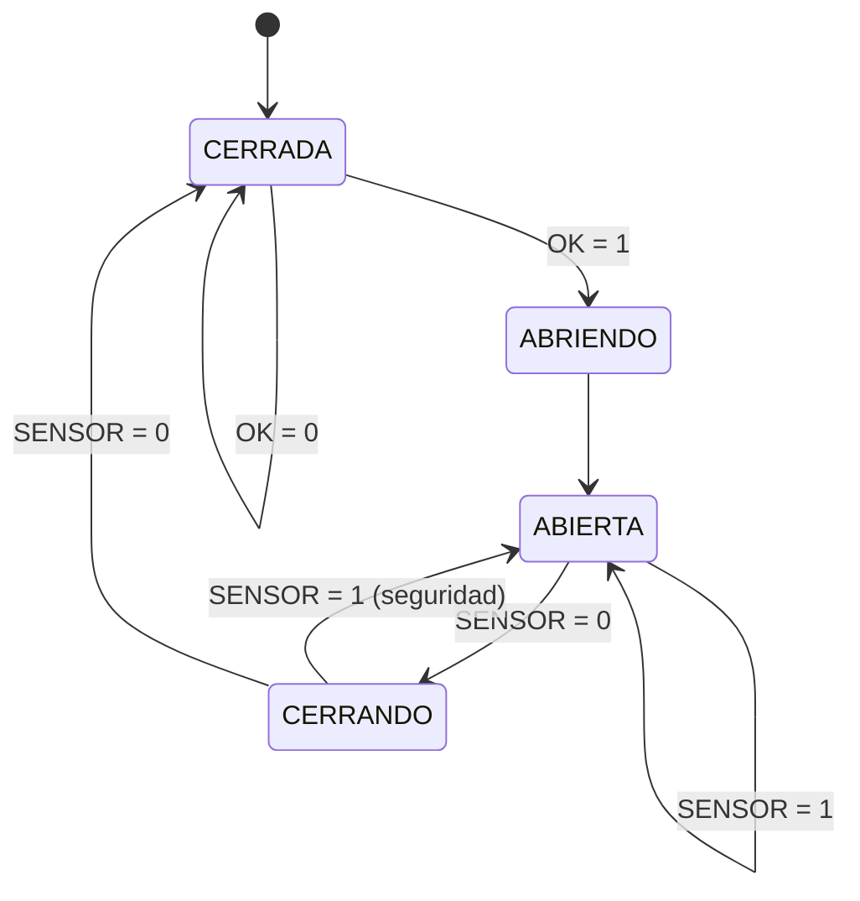

# FSM 1 (Moore) - Controlador de la barrera

4 estados, codificacion binaria (2 flip-flops D, reset asincrono). Las salidas dependen **solo del estado**.

## Entradas y salidas
| Senal | Tipo | Significado |
|---|---|---|
| `CLK` | entrada | reloj comun a las dos FSM |
| `RST` | entrada | reset asincrono (estado 00 = CERRADA) |
| `SENSOR` | entrada | 1 = hay un carro bajo la barrera |
| `OK` | entrada (viene de la FSM 2) | 1 = el codigo secreto fue correcto (`CODIGO_OK`) |
| `CERRADA`, `ABRIENDO`, `ABIERTA`, `CERRANDO` | salidas (Moore) | un LED por estado |

## Codificacion de estados
| Estado | Q1 | Q0 |
|:---:|:---:|:---:|
| CERRADA | 0 | 0 |
| ABRIENDO | 0 | 1 |
| ABIERTA | 1 | 0 |
| CERRANDO | 1 | 1 |

## Diagrama de estados


## Tabla de transicion de estados (con la codificacion)
| Estado actual | Q1 | Q0 | SENSOR | OK | D1 (=Q1') | D0 (=Q0') | Estado siguiente |
|:---:|:---:|:---:|:---:|:---:|:---:|:---:|:---:|
| CERRADA | 0 | 0 | 0 | 0 | 0 | 0 | CERRADA |
| CERRADA | 0 | 0 | 0 | 1 | 0 | 1 | ABRIENDO |
| CERRADA | 0 | 0 | 1 | 0 | 0 | 0 | CERRADA |
| CERRADA | 0 | 0 | 1 | 1 | 0 | 1 | ABRIENDO |
| ABRIENDO | 0 | 1 | 0 | 0 | 1 | 0 | ABIERTA |
| ABRIENDO | 0 | 1 | 0 | 1 | 1 | 0 | ABIERTA |
| ABRIENDO | 0 | 1 | 1 | 0 | 1 | 0 | ABIERTA |
| ABRIENDO | 0 | 1 | 1 | 1 | 1 | 0 | ABIERTA |
| ABIERTA | 1 | 0 | 0 | 0 | 1 | 1 | CERRANDO |
| ABIERTA | 1 | 0 | 0 | 1 | 1 | 1 | CERRANDO |
| ABIERTA | 1 | 0 | 1 | 0 | 1 | 0 | ABIERTA |
| ABIERTA | 1 | 0 | 1 | 1 | 1 | 0 | ABIERTA |
| CERRANDO | 1 | 1 | 0 | 0 | 0 | 0 | CERRADA |
| CERRANDO | 1 | 1 | 0 | 1 | 0 | 0 | CERRADA |
| CERRANDO | 1 | 1 | 1 | 0 | 1 | 0 | ABIERTA |
| CERRANDO | 1 | 1 | 1 | 1 | 1 | 0 | ABIERTA |

## Tabla de salidas (Moore)
| Estado | Q1 | Q0 | CERRADA | ABRIENDO | ABIERTA | CERRANDO |
|:---:|:---:|:---:|:---:|:---:|:---:|:---:|
| CERRADA | 0 | 0 | 1 | 0 | 0 | 0 |
| ABRIENDO | 0 | 1 | 0 | 1 | 0 | 0 |
| ABIERTA | 1 | 0 | 0 | 0 | 1 | 0 |
| CERRANDO | 1 | 1 | 0 | 0 | 0 | 1 |

## Ecuaciones (suma de productos, un termino AND por flecha del diagrama)
```
D1 = Q1'.Q0 + Q1.Q0' + Q1.Q0.SENSOR
D0 = Q1'.Q0'.OK + Q1.Q0'.SENSOR'

CERRADA  = Q1'.Q0'      ABRIENDO = Q1'.Q0
ABIERTA  = Q1.Q0'       CERRANDO = Q1.Q0
```
