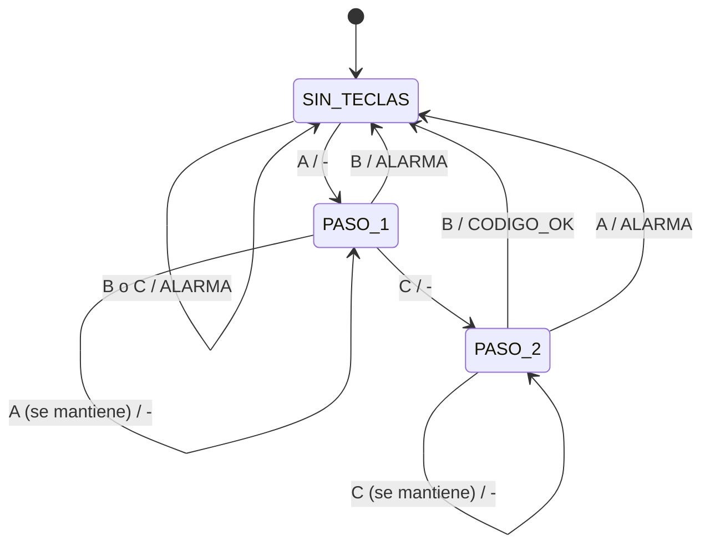

# FSM 2 (Mealy) - Verificador del codigo secreto (A, luego C, luego B)

Detector de secuencia con 2 flip-flops D (reset sincronico). Las salidas dependen del **estado y de las entradas**
(por eso `CODIGO_OK` y `ALARMA` cambian en cuanto se pulsa la tecla, sin esperar el reloj).
Se asume que se pulsa **una tecla a la vez**.

## Entradas y salidas
| Senal | Tipo | Significado |
|---|---|---|
| `A`, `B`, `C` | entradas | teclas del teclado (botones) |
| `EN` | entrada (viene de la FSM 1) | 1 = la barrera esta CERRADA (solo entonces se acepta codigo) |
| `RST` | entrada | reset sincronico |
| `CODIGO_OK` | salida (Mealy, va a la FSM 1) | se pulso B con A y C ya correctas |
| `ALARMA` | salida (Mealy) | tecla equivocada en cualquier paso |
| `PASO_1`, `PASO_2` | salidas (de estado) | progreso del codigo (LEDs) |

## Codificacion de estados
| Estado | P1 | P0 | Significado |
|:---:|:---:|:---:|:---:|
| SIN_TECLAS | 0 | 0 | ninguna tecla correcta todavia |
| PASO_1 (A ok) | 0 | 1 | la A ya se pulso |
| PASO_2 (A,C ok) | 1 | 0 | A y C ya se pulsaron |
| (no usado) | 1 | 1 | se trata como 00 |

## Diagrama de estados (Mealy: tecla / salida), con EN = 1

Si `EN = 0` (barrera no cerrada) o `RST = 1`, de cualquier estado se vuelve a SIN_TECLAS.

## Tabla de transicion y salidas (EN = 1, RST = 0)
| Estado actual | P1 | P0 | Tecla | Estado siguiente | P1' | P0' | Salida (Mealy) |
|:---:|:---:|:---:|:---:|:---:|:---:|:---:|:---:|
| SIN_TECLAS | 0 | 0 | ninguna | SIN_TECLAS | 0 | 0 | - |
| SIN_TECLAS | 0 | 0 | A | PASO_1 (A ok) | 0 | 1 | - |
| SIN_TECLAS | 0 | 0 | B | SIN_TECLAS | 0 | 0 | ALARMA |
| SIN_TECLAS | 0 | 0 | C | SIN_TECLAS | 0 | 0 | ALARMA |
| PASO_1 (A ok) | 0 | 1 | ninguna | PASO_1 (A ok) | 0 | 1 | - |
| PASO_1 (A ok) | 0 | 1 | A | PASO_1 (A ok) | 0 | 1 | - |
| PASO_1 (A ok) | 0 | 1 | B | SIN_TECLAS | 0 | 0 | ALARMA |
| PASO_1 (A ok) | 0 | 1 | C | PASO_2 (A,C ok) | 1 | 0 | - |
| PASO_2 (A,C ok) | 1 | 0 | ninguna | PASO_2 (A,C ok) | 1 | 0 | - |
| PASO_2 (A,C ok) | 1 | 0 | A | SIN_TECLAS | 0 | 0 | ALARMA |
| PASO_2 (A,C ok) | 1 | 0 | B | SIN_TECLAS | 0 | 0 | CODIGO_OK |
| PASO_2 (A,C ok) | 1 | 0 | C | PASO_2 (A,C ok) | 1 | 0 | - |

La tabla completa (todas las combinaciones de P1, P0, A, B, C, EN, RST con una tecla a la vez) esta en
`fsm2_mealy_transiciones_y_salidas.csv`.

## Ecuaciones
```
Next state logic:
D1 = RST'.EN.P1'.P0.C + RST'.EN.P1.P0'.A'.B'
D0 = RST'.EN.P1'.P0'.A + RST'.EN.P1'.P0.B'.C'

Output logic (Mealy):
CODIGO_OK = EN.P1.P0'.B.A'.C'
ALARMA    = EN.(P1'.P0'.B + P1'.P0'.C + P1'.P0.B + P1.P0'.A)
PASO_1 = P1'.P0        PASO_2 = P1.P0'
```
